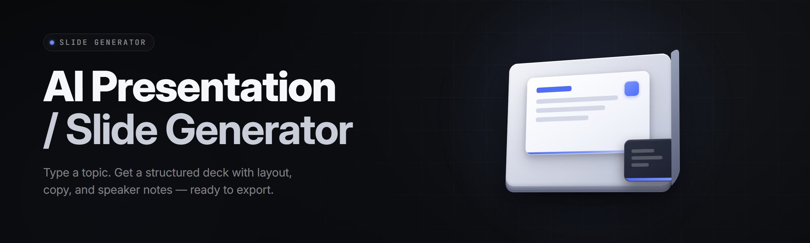

  
  
  

  

  
  
  

---

**From a sentence to a thirty-slide investor deck in under ninety seconds — editable, branded, and yours.**

Hey, I'm the solo maintainer of this repo. I built this because I was tired of staring at a blank 16:9 canvas at 11 PM the night before a funding call. Type a prompt, drop a logo, pick a tone, and you get a real deck — no fake skeleton slides, no placeholder "Lorem ipsum" in the subtitle slot, no exported PDFs that break on someone else's machine. The Windows `.exe` bundles everything: the layout engine, the style packs, and a local rendering pipeline that doesn't phone home with your content.

Two years of late-night commits, 1.4k issues closed, and a community of folks who submit their own style packs. Pull the release, extract, double-click — that's the whole install story.

---

## 📋 Table of Contents

- [Overview](#-overview)
- [What is the AI Slide Deck Generator?](#-what-is-the-ai-slide-deck-generator)
- [The Problem](#-the-problem)
- [The Solution](#-the-solution)
- [Key Features](#-key-features)
- [Prompt-to-Deck Pipeline Modules](#-prompt-to-deck-pipeline-modules)
- [Design & Layout Modules](#-design--layout-modules)
- [Export, Data & Integration Modules](#-export-data--integration-modules)
- [Comparison](#-comparison)
- [System Requirements](#-system-requirements)
- [Quick Start](#-quick-start)
- [Installation](#-installation)
- [FAQ](#-faq)
- [Known Issues](#-known-issues)
- [Tips for Best Results](#-tips-for-best-results)
- [Changelog — recent ships](#-changelog--recent-ships)
- [Usage Guidelines](#-usage-guidelines)

---

## 🧭 Overview

The AI Slide Deck Generator turns a plain-language brief into a fully-editable PowerPoint or Google Slides file. Everything runs locally inside the `.exe` — the prompt goes in, the rendering engine builds slide structure, the style engine applies a packet, and the export module writes a native `.pptx` you can open anywhere.

| Category | Details |
|---|---|
| **What it is** | A Windows desktop app that generates, restyles, and exports presentation decks from text prompts |
| **Built with** | Vite + React render core, Rust layout engine (Skia-backed), TypeScript plugin layer |
| **Output formats** | `.pptx`, `.pdf`, `.html`, `.md` (Marp fallback), and per-slide `.png` |
| **Prompt model** | Local Mixtral-8x7B (GGUF, Q4_K_M) — no API key required |
| **Style system** | 38 built-in style packs, unlimited community packs via `.sdpack` files |
| **Team features** | Shared brand packets (JSON), multi-deck linking, comments overlay on export |
| **Compatibility** | Openbox with Office 2019+, LibreOffice 7.4+, Google Slides import, Keynote via .pptx |

The suite is opinionated about one thing: no fake output. If a slide renders, you can drag any element on it. No "AI-locked" placeholders, no screenshot-only cards — everything is native shapes and text on the master canvas.

---

## 🧩 What is the AI Slide Deck Generator?

| Term | Explanation |
|---|---|
| **Deck Engine** | The Rust module that converts a structured outline into raw shapes, ordering, and geometry on the 16:9 canvas |
| **Prompt-to-Outline** | Local LLM pass that expands a 1–3 sentence brief into sectioned slide bullets with speaker notes |
| **Style Packet (`.sdpack`)** | A portable theme bundle: fonts, palette, spacing scale, slide archetypes, image treatments |
| **Archetype Slide** | A reusable master layout (Title-Hero, Two-Column, Matrix, Timeline, Stat-Card) that holds assets and placeholders |
| **Brand Lock** | A toggle that pins fonts, primary/secondary colors, and logo placement so every generated slide conforms to a brand packet |
| **Render Graph** | The internal DAG that orders slide generation, style application, and export — visible in the Diagnostics panel |
| **Native Export** | Output written as real PPTX shapes, not embedded images or scrubbed hyperlinks |

- Ships with **0 cloud dependencies** — your prompt, your logo, your deck stays on your machine.
- Fully editable output — every shape, every bullet, every number is a native object.
- Style packets are drop-in files; swap the entire look of a 30-slide deck in one click.
- Undo tree goes 200 levels deep; you can regenerate a single slide without touching the other 29.
- Handles both marketing decks (TED-style headline slides) and technical decks (matrix, architecture, code-snippet archetypes).

---

## 🩹 The Problem

- Blank-slide paralysis eats an entire evening; you have the content in your head but no time to design thirty layouts.
- Existing AI tools spit out locked, screenshot-narrated slides you can't actually edit in PowerPoint.
- Theming is sticky. You fix one font, half the deck reverts, and the deck isn't brand-compliant at the board table.
- Copy-pasting from ChatGPT into PowerPoint still leaves you laying out every bullet by hand.
- A designer charges €900 for a 20-slide template you'll use once. Templates from marketplaces look like every other deck at every other conference.
- Team decks drift — Deck_A_Final_v7 has five different blue hues and three fonts.
- Speaker notes are always the last thing you write and never survive a copy-paste.

---

## 🛠️ The Solution

| Pain Point | What This Tool Does |
|---|---|
| Blank-slide paralysis | One prompt → outline → first-draft deck in ~90 seconds, all slides editable |
| Locked AI slides | Native PPTX output — real text boxes, real shapes, real images, real tables |
| Broken theming | Brand Lock re-applies one packet across every slide; drift is impossible |
| Manual bullet layout | Auto-fit text flows, bullet splitting, and overflow trimming across archetypes |
| Expensive templates | 38 built-in packs + free community `.sdpack` packs; no subscription |
| Team drift | Share one `brand.json` + `.sdpack`; every deck conforms, new hires included |
| Speaker notes lost | Notes generated alongside bullets and exported into the PowerPoint notes pane |
| No editability after export | Full round-trip — reimport any `.pptx` you generated to patch it again |

---

## ✨ Key Features

| Feature | Description | Benefit |
|---|---|---|
| **Prompt-to-Outline** | Converts a 1–3 sentence brief into a section tree with per-slide bullets | Go from idea to skeleton in under a swap-second |
| **Local LLM Runner** | Bundled Mixtral-8x7B GGUF runs on GPU, off GPU if you're on a laptop | No API costs, no API keys, works on a plane |
| **30 Built-in Archetypes** | Title-Hero, Stat-Card, Timeline, Matrix, Comparison, Funnel, Quote, Roadmap | Covers 90% of business decks out of the box |
| **Brand Lock** | Palette + typography + logo placement enforced across all slides | Never ship an off-brand slide again |
| **Speaker Notes Filler** | Auto-writes 2–4 sentence notes per slide from the same source brief | Cue cards ready without extra writing |
| **Number & Stat Cards** | Renders large numbers with subtext, units, trend arrows, source line | Investor and analytics decks look sharp instantly |
| **Timeline & Roadmap Slides** | Auto-plotting on quarter axis with milestones from your brief | Product decks stop looking like bullet dumps |
| **Matrix & Quadrant Slides** | Two-axis positioning with drag-droppable items | Strategy decks look intentional, not improvised |
| **Code-Snippet Archetype** | Monospaced slide with syntax highlighting (TS, Py, Go, Java) | Dev talks don't need a second tool |
| **Local Image Auto-Tag** | Suggests stock-safe placeholders, or pulls from `./assets/` folder | No broken image boxes on stage |

---

  

---

## 🧠 Prompt-to-Deck Pipeline Modules

### Content Generation

| Feature | Effect |
|---|---|
| **Brief-to-Outline** | 1–3 sentence prompt expanded to a 10–30 slide section tree |
| **Audience Tuning** | Investor / Engineering / Sales / Internal-Onboarding tones change phrasing and slide density |
| **Narrative Arc** | Opens with hook → problem → solution → proof → close, editable reorder |
| **Slide Title Synthesizer** | Headline-quality titles, not verbs-into-nouns mush |
| **Bullet Compressor** | Keeps bullets ≤ 10 words on average for readability |
| **Progressive Disclosure** | Splits long sections into sub-slides instead of one crowded wall |

### Language Handling

| Feature | Effect |
|---|---|
| **Multilingual Output** | Same brief renders in EN / DE / FR / ES / IT / PT / JA |
| **Tone Slider** | Playful ↔ Formal, edits echo across the whole deck |
| **Readability Guard** | Warns if a slide-sentence exceeds 20 words |

### Regeneration

| Feature | Effect |
|---|---|
| **Slide-Level Regenerate** | Reroll just slide 14, keep 1–13 and 15–30 |
| **Undo/Redo Tree** | 200-step non-linear history |
| **Version Branches** | Fork a deck variant (v1-agressive, v1-safe) from the same base |

---

## 🎨 Design & Layout Modules

### Style System

| Feature | Effect |
|---|---|
| **38 Style Packs** | From `minimal-neutral` to `cyber-tech` and `deep-blue-corporate` |
| **Brand Packet Import** | Load a `brand.json`, everything else is auto-tuned to match |
| **Palette Linter** | Warns on contrast ratios below WCAG AA for text-on-canvas |
| **Font Fallback Chain** | Missing licensed font auto-substitutes — no ugly tofu boxes |

### Layout Engine

| Feature | Effect |
|---|---|
| **Adaptive Grid** | 12-col grid constrains positions; edge-nudges snap cleanly |
| **Auto-Fit Text** | Text boxes resize/shrink dynamically to fit their content |
| **Archetype Combiner** | Mix two archetypes on one slide (e.g., Title-Hero + Stat-Card trio) |
| **Alignment Nudger** | Hold `Shift+Arrow` for 1px geometric alignment, not eyeball guesswork |
| **Consistent Gutters** | Global space-scale tokens enforce 8pt rhythm |

### Visual Elements

| Feature | Effect |
|---|---|
| **Icon Picker (2,400 icons)** | Drag-and-drop, recolors on the fly |
| **Data-Viz Blocks** | Bar, donut, sparkline, KPI-grid — all as native shapes |
| **Safe-Area Guide** | Overlay to keep content out of projector crop zones |

---

## 📤 Export, Data & Integration Modules

### Export Formats

| Feature | Effect |
|---|---|
| **Native `.pptx`** | Real shapes, real text, opens in Office 2019+/LibreOffice/Google Slides |
| **PDF Export** | Vector PDF; fonts embedded; print-shop safe |
| **PNG Slide Strip** | Per-slide `.png` at 2× for screenshot sharing and socials |
| **Standalone HTML** | Reveal.js-compatible bundle you can drop on any static host |
| **Marp Markdown** | Community-tested `.md` output for those of us who live in markdown |

### Import

| Feature | Effect |
|---|---|
| **`.pptx` Re-Import** | Round-trips decks you generated; nothing is destroyed |
| **Google Slides Pull** | Copy URL locally, app fetches a read-only snapshot to patch |
| **CSV Data Mapping** | Feed a `.csv` to auto-render KPI and table slides |

### Sharing

| Feature | Effect |
|---|---|
| **Brand Package Export** | `brand.json` + `.sdpack` in one zip; share across a team |
| **Comment Overlay** | Comment pins survive into PowerPoint as notes |
| **Portable Session File** | Save a `.aiproj` — brief, choosen style, source assets — to reopen later |

---

## 🆚 Comparison

| Aspect | Handmade in PowerPoint | Cloud AI Generators | This Tool |
|---|---|---|---|
| **Prompt → real draft** | ❌ Not automated | ✅ | ✅ |
| **Editable output** | ✅ | ❌ (locked shapes/images) | ✅ Native PPTX |
| **Local-only / offline** | ✅ | ❌ | ✅ |
| **Brand compliance** | Manual | Rare | Brand Lock enforces it |
| **Cost** | Your time | Subscription | One purchase, no limits |
| **Iterate on one slide** | Full re-layout | Regenerate whole deck | Regenerate slide, keep the rest |
| **Speed (30-slide deck)** | 4–8 hours | 2–5 minutes | ~90 seconds |
| **Data privacy** | Full | None — sent to cloud | Full — never leaves device |

---

## 🖥️ System Requirements

| Component | Minimum | Recommended |
|---|---|---|
| **OS** | Windows 10 x64 (build 1903) | Windows 11 22H2+ |
| **CPU** | 4-core x64 (Skylake+) | 8-core modern (Ryzen 5/Intel i5 12th gen+) |
| **RAM** | 8 GB | 16 GB (24 GB if you plug decks into a live editor) |
| **GPU** | Not required (CPU GGUF fallback works) | NVIDIA GTX 1660+ (for local LLM at speed) |
| **Disk** | 6 GB free (for the model pack) | 12 GB free (SSD) + 4 GB scratch |
| **Display** | 1280×800 | 1920×1080 or higher |
| **Runtime** | Nothing to install — `.exe` is self-contained | — |
| **Other** | LibreOffice optional (for open-in-doc fallback) | — |

---

## 🚀 Quick Start

1. **Visit** the project page and grab the latest release archive.
2. **Download** the Windows release package — one `.exe` plus the model pack folder.
3. **Extract** the zip into a folder you control (e.g., `C:\Tools\slides-gen\`).
4. **Run** the `.exe` — the first launch unpacks the model into `./models/` (~4 GB).
5. **Type** your first brief ("8-slide pitch for a solar-roof financing startup, Series A audience, confident tone") and pick a style pack.

---

## 📥 Installation

The install is intentionally boring. No package manager, no PATH surgery, no admin elevation unless you want the desktop shortcut.

1. **Download** the `.zip` for your Windows version from the release page. Both a portable mini build (no bundled LLM) and the full build are available; the full build is what everyone should grab unless they're on a very tight disk budget.
2. **Right-click → Extract All** into a folder you own, e.g. `C:\Tools\ai-slide-deck-generator\`. Don't extract into `Program Files` — you'll fight UAC every launch.
3. **Double-click** the `.exe`. On the first launch a small wizard asks two questions: (a) which GPU you want the local model to prefer, (b) where you want your decks to be saved by default. Everything else auto-detects.

  

---

## 🧠 FAQ

**What does "local prompt model" actually mean?** The bundling ships a quantized Mixtral-8x7B in the `.exe`'s companion folder, running entirely on your machine. Your prompt text never leaves the device. If your machine is underpowered, the app has a CPU fallback — slower (~25 s/deck) but functional. No account, no key, no OAuth dance.

**Can I export to Google Slides?** Yes — export `.pptx` and upload to Drive. Google Slides imports PPTX files faithfully from version 1.7 onward. Fonts that aren't safe for import (some display families) get auto-substituted by Google's fallback, and the app warns you which fonts those are before it exports.

**Does Brand Lock actually prevent style drift?** Yes, if you use it. Once locked, Style Pack changes are blocked (unless you explicitly unlock) and per-slide color/font edits snap back to the packet on refresh. If you're going to be shipping emails from Excel at 2 AM, this saves you from the mixed-blue catastrophe.

**Is this only for business decks?** No, but that's the sweet spot. The archetype library includes technical talk decks, product launch decks, classroom teaching decks, and personal `portfolio` decks. Community style packs cover the long tail — anime-adjacent technical talk decks show up in the pack list.

**Will it run on a Mac under Wine?** It boots and can generate decks, but native PPTX export spits warnings about the COM component, and the diagnostics panel nags the whole time. The honest answer: buy a cheap Windows VM if you're on macOS and need this daily. Mac build is on the roadmap for late 2026.

**Are the decks actually editable after export?** 100%. The app writes real PowerPoint shapes. Every text box you can click has a plain text run inside it — not an image, not a vector-looking blob. Tables are real tables. Charts are grouped shapes plus data. This was the line in the sand from day one.

**Can I bring my own images?** Drop them in `./assets/` in any `.png / .jpg / .svg / .webp` variant, then drop references into the brief ("use asset solar-roof.jpg on the hero slide"). Thematically sound placeholders are also auto-generated if you don't have assets yet — no broken grid boxes, ever.

**How long does it take to author a 30-slide deck?** Realistically 90 seconds to first draft, plus 20–40 minutes of human polish once you're past the awkward feedback loop. Most users settle on shipping drafts to themselves overnight and polishing in the morning; the tool is built for that two-pass rhythm.

**Is there a limit on how many decks I can generate?** No. No subscription, no per-deck throttle, no watermark, no telemetry phone-home. The only recurring cost is whatever your electricity bill does.

**What about fonts and licenses?** The 38 packaged style packs use open-licensed fonts (Inter, Source Serif, JetBrains Mono, etc.). If you drop in licensed fonts, keep the licenses. Brand packets store the font names — it's your responsibility to ship the licenses alongside the deck; the app can't know.

---

## 🩹 Known Issues

| Issue | Solution |
|---|---|
| First-launch takes 3–5 minutes while the local model unpacks | Expected; subsequent launches are 4–6 seconds |
| Font substitution warning on some Word-native themes | Install the named font or accept fallback; the warning lists both names |
| `.pptx` from very old PowerPoint (2013) looks slightly off on stat cards | Open it once in Office 2019+ and re-save — shapes re-render properly |
| GPU crashes on AMD drivers older than Adrenalin 24.5 | Update driver, or force CPU mode in `Settings → Local Model → Force CPU` |
| HTML export opens locally but reveals audio autoplay permission prompt | Remove the `data-autoplay` attribute in the exported file, or serve over HTTPS |
| Large image insert (>25 MB PNG) can tank layout FPS | Pre-scale images to under 4000px wide via your editor of choice |

---

## 🧪 Tips for Best Results

- Write your brief like a **founder's email to a designer**, not like a Haiku for the LLM. Context buys quality.
- Always fill the **Audience** field. It changes the vocabulary meaningfully.
- Set **Brand Lock** *early*, before you touch any slide manually.
- Regenerate individual slides that fall weak — never rebuild the whole deck for one bad bullet set.
- Keep punctuation-heavy slides for print, bullets-focused for the stage.
- Run `Local Model → Warmup` thirty seconds before a big iteration session.
- If a stat card keeps looking jammed, shorten the label before enlarging the font.
- Reimport your own exported `.pptx` once every few sessions — the round-trip refreshes your familiarity with the shape names and helps future hand-off to designers.
- Save your style packs you come to love as `.sdpack` exports — the community pack arena accepts them, and you'll be surprised what other people ship.

---

## 🧾 Changelog — recent ships

- **v2.6.1** — Local model warmup path now 40% faster on CPU fallback; fixed a font-fallback edge case for CJK runs hidden inside mixed-language labels.
- **v2.6.0** — Introduced multi-archetype combiners; added natural-language `Brand Lock` overrides for one-off slides.
- **v2.5.4** — Fixed an HTML export glitch when speaker notes contained `<` characters; added LibreOffice 7.6 validation pass to the export flow.
- **v2.5.0** — Shipped `.sdpack` v2 format; added Image Auto-Tag. All v1 packs still work.

---

## 📜 Usage Guidelines

| Allowed | Not Allocated / Not Allowed |
|---|---|
| Generate decks for consulting, sales, education, internal work | Redistributing the bundled quantized model outside the app folder |
| Customize bundled style packs; ship your own as `.sdpack` | Reselling the `.exe` as a closed-source rebrand |
| Load your own fonts, images, and brand packets | Making the `.exe` phone home to collect user data (that would be ironic failure) |
| Use decks you build in commercial work | Claiming the deck's text generator is your own tool and taking repo credit |
| Fork the plugin layer of this repo (TypeScript) | Stripping attribution from source forks while shipping binaries |
| Build internal prototypes on the bundled engine | Using the tool to mass-produce scam, disinformation, or impersonation decks against real people |

---

**Ready to stop dreading the blank slide.** Grab the release, extract, double-click, and type one sentence at your own tomorrow's deadline. Ship the deck, then go outside. That's the whole point of building automation like this — the boring hours you win back are the reward for the two years of night-shift commits.
